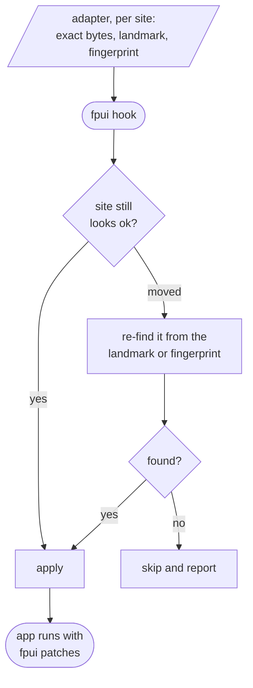
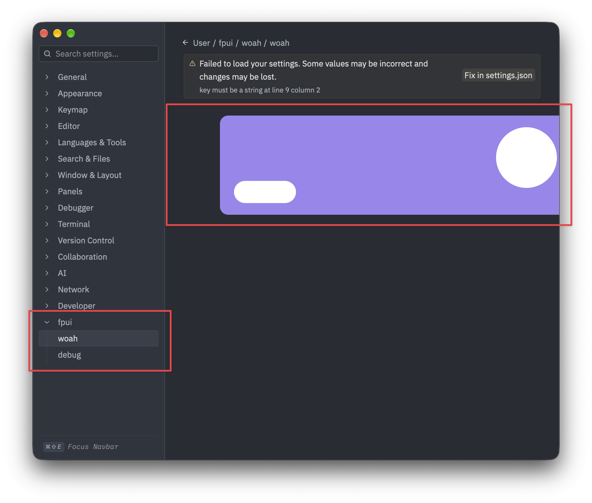

# fpui

[website](https://fpui.dev) (do NOT trust the documentation on the site, it is written by ai and is severely out of date.)

fpui modifies native desktop apps from the inside **without having access to the apps source code**.

it loads a small piece of its own code into the app as the app starts and there it finds the exact functions and data it wants to change, and rewrites them, think of it as automated cheat engine.

features:
- add stuff
- change how an app behaves
- add native ui (see more information below)

it also survives app updates (see fpui-monitor for more inofrmation)

our main target is [gpui](https://www.gpui.rs/) and this framework was made by targeting [zed](https://zed.dev) however, the internal tooling required e.g. hooking/running/etc do not depend on gpui.

> [!IMPORTANT]
> fpui is very early and requires an adapter for each app that it modifies.

## fpui patching

fpui describes each thing it wants to change as a "site". for one exact version of an app, an adapter records three things per site: 
- the exact bytes of the instruction or function
- a nearby landmark (a unique piece of text the code refers to)
- a fingerprint of the surrounding code.

when fpui runs, it re-checks that a site still looks right before it decides to do a patch so that if the app updates and/or the site moved, fpui can find it again from its landmark or fingerprint. 

in order to do this fpui is injected with `DYLD_INSERT_LIBRARIES` and is hooked with frida-gum so we can patch stripped release Mach-O binaries that carry no symbols

## capabilities

| kind | what it does |
|---|---|
| recolor | change a theme colour |
| event | turn a function call into a plugin event |
| after | change what a function returns |
| before | change an argument before a function runs |
| replace | swap out a function entirely |
| patch | overwrite text, or neutralise a function, in place |
| add-to-list | add an item to a list the app builds, for example a new settings category |
| paint | draw shapes and images into the app's live screen |
| element | add a real native UI element to the app |

## native ui

> [!IMPORTANT]
> native ui and painted ui is different, for painted ui: you will deal with all the rendering, positioning, everything yourself including painting it pixel by pixel. **that sucks** and is in no way ever good to use unless you're planning on playing bad apple on top of everything.

**native ui is a pain in the ass because the app's UI building blocks (`div`, `Label`, and so on) get compiled straight into the app, with nothing left over to call, so you can't ask the app to build a widget for you.**

in order to deal with this monstrosity, fpui builds its own UI element by hand (you need to supply this) and gives it to the app's own UI system. 

doing so:
1. constructs the element's internals byte by byte, including the small table of functions the app will call on it
2. points those functions at its own code
3. slots the element into the app's rendering at the right moment*
4. asks the app's own layout engine for a real layout slot by handing it a hand-built style.

*(injecting it at the wrong moment causes it to render everywhere or cause the app target to freeze)

*fpui inside a real Zed build. A new `fpui` section with `woah` and `debug` pages is added to the settings sidebar, and a hand-built native element is laid out and drawn in the main pane by Zed's own UI system.*

## plugins

modifications are written as small sandboxed plugins, in WebAssembly or in JavaScript (via a built-in JS engine). 

**this is subject to change and honestly, should be changed.**

## crates

| crate | what it is |
|---|---|
| `fpui-target` | defines adapters and the kinds of site |
| `fpui-loader` | the injected agent, the resolver that re-finds a site after an update, and the hooking backend |
| `fpui-host` | runs the plugins |
| `fpui-wasm` | the WebAssembly and JavaScript plugin runtimes |
| `fpui-manifest` | plugin metadata and permissions |
| `fpui-plugin-sdk` | the helper for writing a plugin |
| `fpui-theme` | theme packages, light and dark |
| `fpui-agent` | the small entry point that runs inside the app |
| `fpui-discover` | tooling to help build an adapter for a new target |
| `fpui-monitor` | checks which sites still match a given app build |
| `fpui-install` | install tooling |

## limitations

- each app version needs its own adapter because the exact spots are specific to one build, so a new app, or a new version of the same app, needs its own map even when fpui can recover moved sites.
- the native-UI technique is specific to GPUI apps because its built on GPUI's own ui internals (though it can be moved to other gpui apps)
- this has been tested on macOS, i am unsure whether this works at all on windows or linux, though sandbox testing make it seem like it does
- the app used to test all of this is a striped zed-release which you can view the source of the zed adapter [here](https://github.com/schmayterling/fpui-zed-adapter).

## license

GPL-3.0-or-later.
